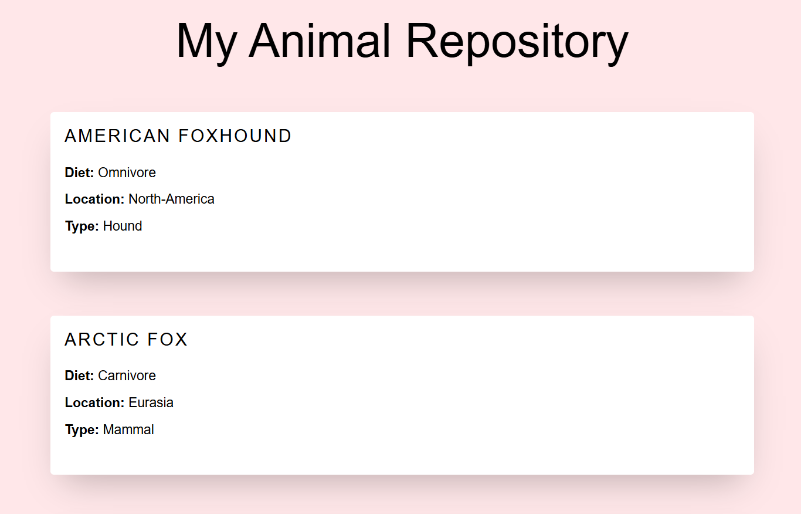

# Zootopia With API



Zootopia is a Python project that generates an HTML website displaying information about animals.

The project uses the [API Ninjas Animals API](https://api.ninjas.com/api/animals) to retrieve animal data based on the user's search input.

It demonstrates how to work with external APIs, handle JSON data, and generate dynamic HTML content using Python.


## Installation

1. Clone this repository:

   ```bash
   git clone git@github.com:jubeXyz/My-Zootopia-API.git
   ```

2. Navigate to the project directory:

   ```bash
   cd My-Zootopia-API
   ```

3. Install the required dependencies:

   ```bash
   pip install -r requirements.txt
   ```


## Configuration

This project requires an API key from [API Ninjas](https://api-ninjas.com/).

1. Get your API key from API Ninjas.
2. Create a file named `.env` in the root directory of the project.
3. Add your API key to the file using the following format:

   ```text
   NINJAS_API_KEY=your_actual_api_key
   ```

Replace `your_actual_api_key` with your own API key.

**Important:** Never share your API key or commit your `.env` file to GitHub. The `.gitignore` file excludes it from version control.


## Usage

1. Open a terminal in the project directory.
2. Run the Python script:

   ```bash
   python animals_web_generator.py
   ```

3. Enter the name of an animal when prompted.
4. The program fetches matching animal data from the API and generates an `animals.html` file.
5. Open `animals.html` in your browser to view the results.

If no matching animal is found, the website displays a message informing the user.


## Project Structure

```text
My-Zootopia-API/
│
├── animals_web_generator.py  # Generates the HTML website
├── data_fetcher.py           # Fetches animal data from the API
├── animals_template.html     # HTML template for the website
├── animals.html              # Generated website
├── requirements.txt          # Required Python packages
├── .env                      # Stores the API key (not committed)
└── .gitignore                # Excludes sensitive and unnecessary files
```

